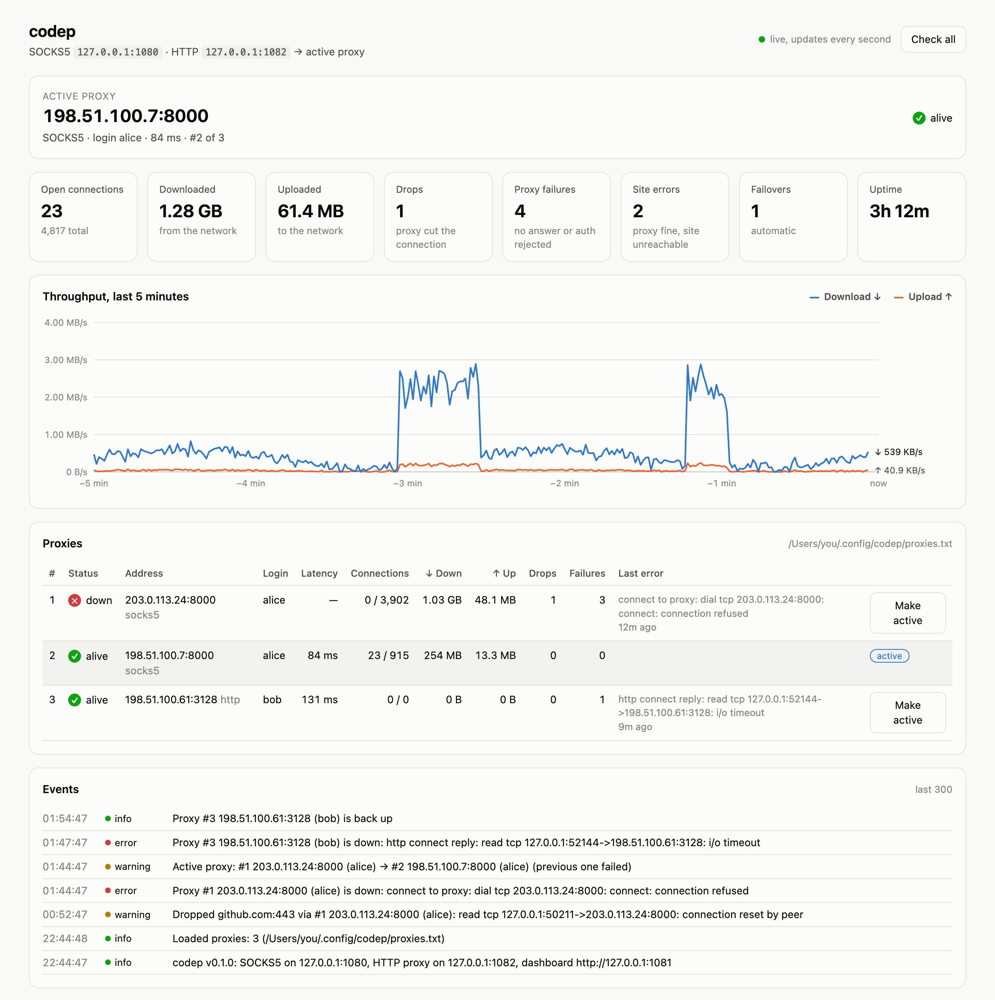

# codep

[](https://github.com/DeveloperMos/codep/actions/workflows/ci.yml)

Run VS Code through a proxy that needs a login and password. codep opens a separate VS Code window where everything goes through your proxy: the built-in browser, extensions, Copilot, and the commands you run in its terminal. Your regular VS Code keeps working without the proxy. If a proxy dies, codep switches to the next one on your list.

<picture>
  <source media="(prefers-color-scheme: dark)" srcset="docs/dashboard-dark.png">
  
</picture>

<sub>The codep dashboard with sample data.</sub>

## The problem

Most paid proxies come as `ip:port:login:password`, and VS Code can't use them well:

- VS Code networking is Chromium, and Chromium can't log in to a SOCKS5 proxy. The [VS Code network docs](https://code.visualstudio.com/docs/setup/network) say SOCKS5 proxy authentication isn't implemented. The `--proxy-server` flag has no place for a login and password either.
- `--proxy-server` applies to the whole app. You can't keep one window behind a proxy and another one direct: VS Code runs as a single process, and every window shares its network settings.
- The integrated terminal ignores VS Code's proxy. `curl`, `git`, `npm`, `pip` and friends read `HTTPS_PROXY` from the environment, and many of them only understand HTTP proxies, not SOCKS5.
- When a proxy goes down, you edit settings and restart by hand.

## How codep solves it

codep runs a small local bridge. It accepts connections without a password on `127.0.0.1` and forwards them through your real proxies, adding the login and password itself.

```
VS Code window (Chromium)  ──SOCKS5──▶  127.0.0.1:1080 ┐
                                                       ├─ codep ── login/password ──▶ proxy #1
terminal: curl, git, npm…  ──HTTP────▶  127.0.0.1:1082 ┘                (failover ▶ #2, #3…)
```

Then `codep` starts VS Code as a second instance with its own data folder, pointed at the bridge, with proxy variables set for its terminals.

- A proxied VS Code window next to your normal one, or the whole VS Code behind the proxy if you prefer (`--all`).
- Terminal commands in the proxied window go through the proxy too. Tested with `curl`, `git` over HTTPS, `npm`, Node.js `fetch` and Python `urllib`.
- SOCKS5, HTTP CONNECT and HTTPS (CONNECT over TLS) upstream proxies, with or without a password.
- Automatic failover, health checks every 30 seconds, and a list file you can edit while it runs.
- A local dashboard with traffic, speed, drops, failovers and an event log.
- A single Go binary with no dependencies, about 6 MB.

Works with VS Code, VS Code Insiders, and forks like Cursor (`--app Cursor`). The launcher and background service are macOS only for now; on Linux you can run the bridge with `codep serve`.

## Install

```bash
curl -fsSL https://raw.githubusercontent.com/DeveloperMos/codep/main/install.sh | sh
```

The script downloads the latest release for your Mac, checks its SHA-256 and puts `codep` into `~/.local/bin` (set `CODEP_BIN_DIR` to change that).

Or with Go 1.23+:

```bash
go install github.com/DeveloperMos/codep@latest
```

## Quick start

1. Start the bridge in the background. It also starts at login:

   ```bash
   codep install
   ```

2. Add your proxies to `~/.config/codep/proxies.txt` (the file was created on the previous step):

   ```text
   1.2.3.4:8000:login:password
   ```

3. Open the dashboard at http://127.0.0.1:1081 and check that the proxy shows as alive.

4. Open a project through the proxy:

   ```bash
   codep ~/my/project
   ```

5. In the new window, open a terminal and run `curl https://ifconfig.me`. You should see the proxy's IP, not yours.

After that, `codep [path]` is all you run day to day. The bridge keeps running in the background and starts again after a reboot.

## Start and stop the bridge

The background bridge is a launchd service, so it needs no process manager.

```bash
codep install     # start it and add it to login items
codep uninstall   # stop it and remove it from login items
```

To stop it for a while and keep it in login items:

```bash
launchctl bootout gui/$(id -u)/io.github.codep                                  # stop until the next login
launchctl bootstrap gui/$(id -u) ~/Library/LaunchAgents/io.github.codep.plist   # start again
launchctl kickstart -k gui/$(id -u)/io.github.codep                             # restart
```

`launchctl stop` doesn't work here: launchd restarts the service right away. To run the bridge without launchd, use `codep serve`; it stops with Ctrl+C.

## Two modes

**Separate window (default).** `codep [path]` starts a second VS Code instance next to your regular one. Running `codep` again while it's open sends the new folder to the same proxied instance.

The second instance keeps its state in `~/Library/Application Support/codep/<app>`. On first launch codep links your `settings.json`, `keybindings.json`, `snippets`, `tasks.json` and `mcp.json` from the main VS Code, so changes in one show up in the other. To keep a file separate, delete the link and put a real file there. Extensions live in `~/.vscode/extensions` and are shared. Sign-ins are not shared, so GitHub, Copilot or Settings Sync may ask you to sign in once. If you use a non-default VS Code profile, its settings are not linked.

**Whole VS Code.** `codep --all [path]` quits VS Code, waits for it to exit and starts it again with the proxy for every window. If VS Code asks about unsaved files, answer and the restart continues. This works from VS Code's own terminal: the restart runs in a detached process.

Options:

| Flag | Default | Meaning |
|---|---|---|
| `--all` | off | restart the app itself with the proxy for every window |
| `--app` | `Visual Studio Code` | app name: `Visual Studio Code - Insiders`, `Cursor`, … |
| `--data-dir` | one per app | state folder of the separate instance; several folders give several independent proxied setups |
| `--socks` | `127.0.0.1:1080` | SOCKS5 address of the bridge |
| `--http` | `127.0.0.1:1082` | HTTP address of the bridge, used by terminals |

## Terminal

In the proxied window every terminal gets:

```text
HTTP_PROXY / HTTPS_PROXY / http_proxy / https_proxy = http://127.0.0.1:1082
NO_PROXY / no_proxy = localhost,127.0.0.1,::1
NODE_USE_ENV_PROXY = 1     # makes Node.js fetch and http honor the variables
CODEP = 1                  # marker for your prompt
```

Nothing changes in your shell config. To show the proxy state in a zsh prompt:

```zsh
[[ -n $CODEP ]] && PROMPT="(codep) $PROMPT"
```

For another terminal app, load the same variables with:

```bash
eval "$(codep env)"
```

Not covered: `git` over SSH (`git@github.com:…`) and programs that ignore `HTTPS_PROXY`.

## Proxy list

`~/.config/codep/proxies.txt`, format `ip:port:login:password`. One per line, or several on a line separated by commas:

```text
1.2.3.4:8000:login:password
5.6.7.8:8000:login:password, 9.10.11.12:8000:login:password
http://13.14.15.16:3128:login:password
10.0.0.1:1080
```

- Separators: newline, comma, semicolon, space. Lines starting with `#` are skipped.
- The password may contain colons: everything after the third `:` is the password. Commas, semicolons and spaces can't be used in a password.
- `ip:port` without a login works too.
- The default type is SOCKS5 (`-type` flag). Set it per line with `socks5://`, `http://` (HTTP CONNECT) or `https://` (HTTP CONNECT over TLS). If your provider calls a proxy "HTTPS", it usually means a plain HTTP proxy that tunnels HTTPS, so use `http://`.
- Duplicates are dropped. Broken lines go to the event log without the password.

The file is checked every 3 seconds. New proxies are picked up on the fly, and the remaining ones keep their stats. The file holds passwords, so codep creates it readable by you only.

## Failover

1. All connections go through the active proxy. At start it's the first one in the list.
2. If the proxy fails (no TCP connection, wrong login, broken handshake), it is marked down, the next alive proxy becomes active, and the same connection is retried through it. Up to 5 proxies per connection (`-attempts`).
3. If the proxy answers but can't reach the site (SOCKS5 "host unreachable", HTTP 502 and so on), the site is at fault. The proxy stays active and the error counts as a site error.
4. Every 30 seconds codep checks all proxies by connecting to `1.1.1.1:443` (`-check-interval`, `-check-target`). A recovered proxy is marked alive but doesn't become active again: codep stays on the current one while it works, so your IP doesn't jump around. Use "Make active" in the dashboard to switch by hand.
5. If every proxy is down, codep logs it and keeps trying them on each new connection.

A drop is counted when the proxy resets the connection mid-transfer, or closes it and then fails a health check right away. A normal close by the site or by VS Code is not a drop.

## Dashboard

http://127.0.0.1:1081, refreshed every second: active proxy and latency, open and total connections, traffic, drops, proxy failures, site errors, failovers, a 5-minute throughput chart, a table of all proxies with a "Make active" button, and the last 300 events (see the [screenshot](#codep) at the top). The same data as JSON: `curl http://127.0.0.1:1081/api/stats`.

The dashboard has no password and listens on `127.0.0.1` only. It shows proxy logins but never passwords. Stats live in memory and reset when the bridge restarts.

## Commands

```text
codep [--all] [--app NAME] [PATH...]   open VS Code through the proxy
codep serve [flags]                    run the bridge in the foreground
codep install [serve flags]            run the bridge in the background, start at login (macOS)
codep uninstall                        stop the background bridge and remove it from login items
codep env                              print proxy variables for other terminals
codep version
```

`codep install` writes `~/Library/LaunchAgents/io.github.codep.plist` and logs to `~/Library/Logs/codep.log`. To change bridge flags, run `codep install` again with them, for example `codep install -check-interval 1m`.

Bridge flags (`serve` and `install`):

| Flag | Default | Meaning |
|---|---|---|
| `-listen` | `127.0.0.1:1080` | local SOCKS5 address |
| `-http-listen` | `127.0.0.1:1082` | local HTTP proxy address, empty disables it |
| `-dashboard` | `127.0.0.1:1081` | dashboard address, empty disables it |
| `-proxies` | `~/.config/codep/proxies.txt` | proxy list file |
| `-type` | `socks5` | type for lines without a scheme: `socks5`, `http`, `https` |
| `-dial-timeout` | `10s` | timeout for connecting through one proxy |
| `-check-interval` | `30s` | how often to check all proxies |
| `-check-target` | `1.1.1.1:443` | where to connect when checking |
| `-attempts` | `5` | how many proxies to try per connection |

## Troubleshooting

### `codep` does something else

Your shell has an alias or function named `codep`, and the shell runs it instead of the program. Check with `type codep`. Remove the alias from your shell config (`~/.zshrc`, `~/.bashrc`, …) and open a new terminal. Until then, call the program as `command codep`, for example `command codep uninstall`. The install script and `codep install` warn when they find such an alias.

### The proxied window doesn't open

Check that the bridge runs: `curl -x socks5h://127.0.0.1:1080 https://ifconfig.me` should print the proxy's IP. If it doesn't, look at `~/Library/Logs/codep.log` and the dashboard. If you pass `--data-dir`, keep the path under 87 characters: VS Code creates a socket inside it, and macOS limits socket paths.

## Limitations

- TCP only. The bridge accepts SOCKS5 CONNECT and HTTP proxy requests, so UDP doesn't go through it. Chromium doesn't use QUIC over a SOCKS proxy, but WebRTC can still send UDP directly.
- DNS is resolved by the proxy: VS Code passes host names to the bridge, and the bridge passes them on.
- The HTTP entry serves one plain `http://` request per connection and closes it after the response. HTTPS goes through CONNECT and has no such limit.
- The bridge listens on `127.0.0.1` only. Any program on your Mac can use it without a password.

## Uninstall

```bash
codep uninstall
rm ~/.local/bin/codep
rm -r ~/.config/codep "$HOME/Library/Application Support/codep"   # proxy list and the separate VS Code state
```

## Development

```bash
make test    # go vet + go test -race
make build   # bin/codep
make dist    # release archives for macOS and Linux in dist/
```

Tests start fake SOCKS5 and HTTP proxies with authentication and check data transfer through both bridge entries, failover on a dead proxy and a wrong password, reloading the list, health checks, drop accounting, and the launcher's arguments and environment.

Releases are built by GitHub Actions when you push a `v*` tag.

## License

[MIT](LICENSE)
